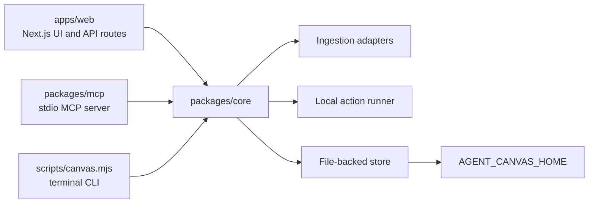

# Starlight Agent Canvas

[](https://github.com/Starlight-Intelligence/starlight-agent-canvas/actions/workflows/ci.yml)

Starlight Agent Canvas is a local, spatial canvas where you and your coding agents work on the same graph of sources, notes, prompts, and outputs.

You paste or drop material into a web canvas and it becomes typed, connected nodes. An agent such as Codex, Claude, or Gemini reads and extends that same canvas through a local MCP server. Everything is stored as files on your machine, and the built-in actions run without any API key.


## Who it is for

- People who research with links, videos, PDFs, and notes and want the result in a form an agent can pick up.
- Developers who use MCP-capable coding agents and want a shared, inspectable context instead of pasting text between chats.
- Operators of the Starlight repo estate, who get planning templates, a seeded operating canvas, and read-only views of estate context.

Version 0.1 is single-user and runs on one machine. There are no accounts, teams, or hosted sync.

## What it does

- **Canvas workspace** (`apps/web`): a Next.js app built on `@xyflow/react`. Drag nodes, connect them, edit titles and bodies, and inspect each source's receipt: kind, ingest method, chunks, and character count.
- **Source intake** (`packages/core/src/ingest.ts`, `source-intake.ts`): YouTube links, other video links, image URLs and uploads, public web URLs, PDFs, text, Markdown, JSON, CSV, and plain notes. Each source is saved as an artifact with chunks and provenance, plus a node on the graph.
- **Local actions** (`packages/core/src/actions.ts`): summarize, extract claims, compare sources, build a decision matrix, write an implementation brief, and answer questions with citations back to source chunks. These are deterministic and make no model calls.
- **Exports** (`packages/core/src/exporters.ts`): portable JSON that can be imported again, readable Markdown, an agent context packet, and a Codex continuation prompt. Exports can cover the whole canvas or selected nodes.
- **MCP server** (`packages/mcp`): a stdio server with tools to list, read, create, and import canvases, add and update nodes, ingest sources, connect nodes, run actions, search artifacts, and export. It has no delete, posting, or payment tools.
- **Checkpoints** (`packages/core/src/checkpoints.ts`): save a named snapshot of a canvas and compare it with the current state or another snapshot. See [docs/checkpoints.md](docs/checkpoints.md).
- **Workflow templates** (`packages/core/src/templates.ts`): starting graphs for competitor teardown, repo and product planning, agent workflow design, and content synthesis.
- **Website directions** (`/website/<canvas-id>`): a workbench for a source-backed website plan stored on the canvas. See [docs/website-directions.md](docs/website-directions.md).
- **Estate views**: `/context` opens an imported Atlas entity packet read-only ([docs/atlas-context.md](docs/atlas-context.md)), and `/continuity` shows session status reported by the Starlight continuity CLI when one is available.
- **Terminal CLI** (`scripts/canvas.mjs`): list, show, import, search, and export canvases without opening the browser. See [docs/cli.md](docs/cli.md).

## Quickstart

Requirements: Node.js 22.13 or newer, pnpm 11.7, and Git.

```bash
git clone https://github.com/Starlight-Intelligence/starlight-agent-canvas.git
cd starlight-agent-canvas
corepack enable
corepack prepare pnpm@11.7.0 --activate
pnpm install
pnpm dev
```

Open `http://127.0.0.1:3000`. The first screen is the workspace. Click `Demo` to load a working example canvas, or paste a link or note into the composer and choose `Map`.

To check the whole local setup in one pass, run the setup script. It builds the MCP server, runs the health check and smoke tests against temporary data, seeds a sample canvas, and prints a Codex MCP config block without writing it.

```bash
node scripts/setup.mjs --skip-install
```

To confirm that a production build boots and can import, map, and export, run:

```bash
pnpm install:proof
```

For a longer walkthrough, see [docs/install.md](docs/install.md) and [docs/demo-walkthrough.md](docs/demo-walkthrough.md).

## Connect an agent over MCP

Build the server, then print a config block with absolute paths for your machine:

```bash
pnpm mcp:build
pnpm mcp:config -- --client json
pnpm mcp:config -- --client codex
```

The JSON form looks like this:

```json
{
  "mcpServers": {
    "starlight-agent-canvas": {
      "command": "node",
      "args": ["/absolute/path/to/starlight-agent-canvas/packages/mcp/dist/cli.js"],
      "env": {
        "AGENT_CANVAS_HOME": "/absolute/path/to/.starlight/agent-canvas"
      }
    }
  }
}
```

For Codex, `pnpm mcp:install:codex` previews the change to `~/.codex/config.toml`, and `pnpm mcp:install:codex -- --write` applies it with a backup. New entries are written with `enabled = false`, so you turn the server on per task. Details are in [docs/codex-integration.md](docs/codex-integration.md).

A short agent session usually calls these tools in order:

```text
get_latest_canvas
ingest_anything(content: "<links, text, and notes>", runAction: "summarize")
enrich_source_node(nodeId: "<source node>", body: "<transcript or notes>", enrichmentKind: "transcript")
export_canvas(format: "codex")
```

Client examples for Codex, Claude Desktop, and Gemini are in [examples/mcp](examples/mcp/README.md). The full tool list and operating notes are in [docs/mcp-setup.md](docs/mcp-setup.md).

## Use the terminal CLI

```bash
pnpm canvas -- demo
pnpm canvas -- list
pnpm canvas -- show latest
pnpm canvas -- search "Codex context handoff"
pnpm canvas -- export latest --format context --out .agent-canvas/demo-context.md
pnpm canvas -- export latest --format codex --out .agent-canvas/demo-codex.md
```

The CLI, the web app, and the MCP server read and write the same data home, so a canvas imported in one shows up in the others.

## Supported inputs

| Input | What the canvas stores |
| --- | --- |
| YouTube URL | `source_youtube` node with title and public captions when available, or a transcript you paste. No video is downloaded. |
| Other video URL (Loom, Vimeo, Wistia, TikTok, Drive, Dropbox, direct links) | `source_video` node kept as a reference. Attach a transcript or notes to make it usable in actions. |
| Image URL or PNG, JPEG, WebP, GIF, AVIF upload | `source_image` node with a preview. Attach OCR text or visual notes for analysis. |
| Public web URL | `source_url` node with fetched readable text, or a saved reference if the fetch fails. |
| PDF upload | `source_pdf` node with text extracted locally. |
| Text, Markdown, JSON, CSV, log | Source artifact with chunks. |
| Note | Editable `note` node that counts as context. |

## Architecture



`packages/core` holds the Zod schemas, the file store, ingestion, actions, checkpoints, and exporters, and has no React or Next.js dependency. The web app, the MCP server, and the CLI are three entry points over that one package and one data directory. Writes are serialized per canvas and go through a temp file and rename.

Each canvas record holds metadata, typed nodes, typed edges, action runs, and source artifacts. More detail is in [docs/system-design.md](docs/system-design.md) and [docs/technology-stack.md](docs/technology-stack.md).

## Configuration

Configuration is done with environment variables. All of them are optional, and `.env.example` lists the names.

| Variable | Purpose |
| --- | --- |
| `AGENT_CANVAS_HOME` | Directory for canvases, artifacts, and checkpoints. Defaults to `<home>/.starlight/agent-canvas`, outside the repository. |
| `AGENT_CANVAS_ALLOW_REMOTE` | Set to `1` to let the web API answer requests from hosts other than localhost. Leave unset unless the deployment is protected. |
| `FIRECRAWL_API_KEY` | Used for URL ingestion only when a request explicitly opts into Firecrawl. |

The dev and production servers bind to `127.0.0.1`. URL ingestion rejects localhost and private network targets and applies timeout and size limits. See [SECURITY.md](SECURITY.md) for the full boundary.

## Project layout

```text
apps/web          Next.js workspace UI, API routes, Playwright tests
packages/core     Schemas, file store, ingestion, actions, checkpoints, exporters
packages/mcp      Stdio MCP server and tool handlers
scripts           Setup, doctor, smoke tests, terminal CLI, release audit
examples          Demo canvas and MCP client config examples
docs              Install guide, system design, product docs, visual QA captures
```

## Development

```bash
pnpm doctor        # check prerequisites, workspace files, and MCP wiring
pnpm typecheck
pnpm test          # unit tests for core and mcp
pnpm build
pnpm verify        # typecheck, test, and build in one command
pnpm mcp:smoke     # exercise the MCP server over stdio with throwaway data
pnpm canvas:smoke  # exercise the terminal CLI with throwaway data
pnpm release:audit # check repository files, CI gates, and runtime-data hygiene
pnpm test:e2e      # Playwright desktop and mobile runs
```

`pnpm test:e2e` needs Playwright's Chromium. Install it with `pnpm --filter @starlight-agent-canvas/web exec playwright install --with-deps chromium`.

## Contributing

Read [CONTRIBUTING.md](CONTRIBUTING.md) before opening a pull request. It covers the local gates to run and the boundaries a change has to respect: runtime data stays out of Git, and MCP tools stay explicit and non-destructive. [AGENTS.md](AGENTS.md) carries the same rules for coding agents.

For help and reports, see [SUPPORT.md](SUPPORT.md). Report vulnerabilities privately as described in [SECURITY.md](SECURITY.md). Project roles are in [GOVERNANCE.md](GOVERNANCE.md) and [MAINTAINERS.md](MAINTAINERS.md), and conduct expectations are in [CODE_OF_CONDUCT.md](CODE_OF_CONDUCT.md).

## License

MIT. See [LICENSE](LICENSE).
